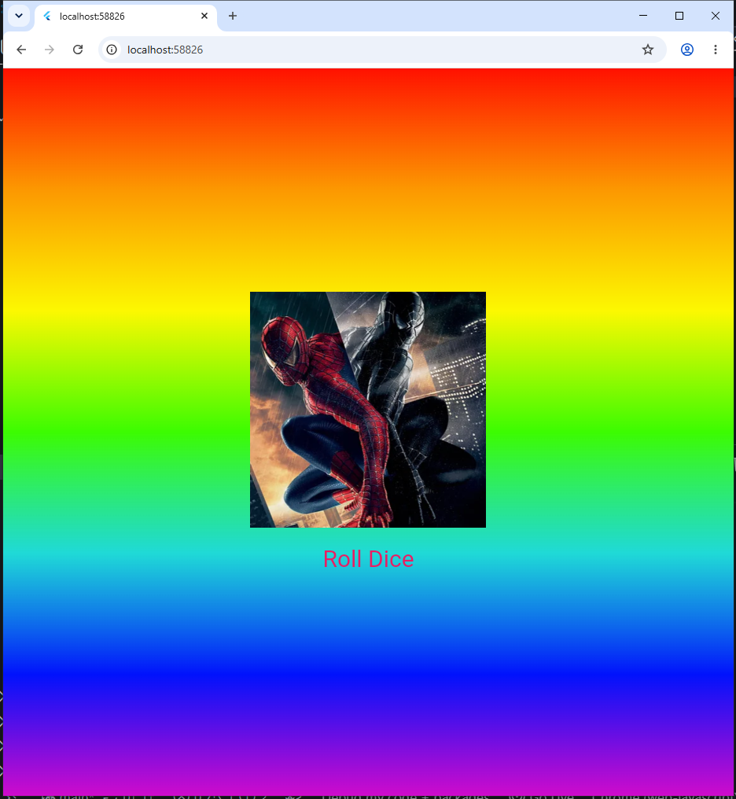

# Лабораторная работа №4-5. Flutter: структура UI и компонентный подход

## Что изучили

1. Как работать со структурой виджетов
2. Как выносить виджеты классы и файлы
3. Как передавать данные
4. Как подключить локальные изображения

## Финальное приложение

## Ссылка на репозиторий

Мой репозиторий:[Git Hub](https://github.com/ALISAKonovalova/Flutter_Lab4.git)

## Инструкция по запуску

Клонировать репозиторий `git clone *Ссылка на репозиторий*`
Перейти в папку `cd Flutter:4`
Скачать зависимости `Flutter pub get`
Запустить приложение `run`

## Ответы на вопросы

1. Выносим для легкого ориентированния если держать всё в
   main.dart код будет не читабельным.
2. объект который держит информацию о местоположении виджета он нужен чтобы флатер знал где рисовать виджет
3. StatelessWidge - не изменяемый виджет
   StatefulWidget -может менять свое состояние
4. чтобы не создавать новый генератор при каждом нажатие на кнопу
